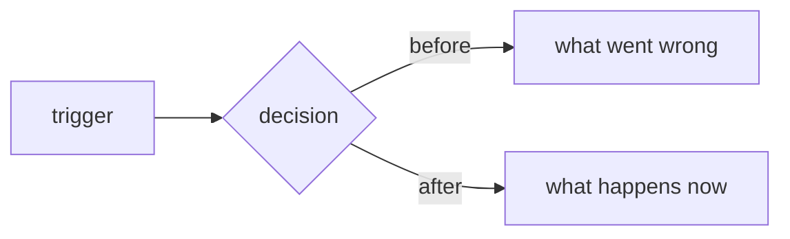

<!--
Write the description in this order, and keep it short enough to read in one
sitting: a reviewer should get the problem, the shape of the fix, and the proof
without opening a terminal.

Rules:
- Delete a section that does not apply. Do not write "n/a".
- Use a diagram when the cause or the flow is not obvious from prose. Keep it
  under about eight nodes: a `flowchart` for a decision, a `sequenceDiagram`
  when two writers or two callers race, a before/after pair when the bug is a
  wrong branch. Delete the skeleton if it does not earn its space.
- Every number comes from a run, not from memory.
- Say plainly what was not verified. An honest gap is cheaper than a wrong
  guarantee.
-->

# Why

<!-- The problem in behaviour terms: what goes wrong, who it affects, what it
costs. Two short paragraphs at most. Show the faulty path when it needs one. -->

# What changed

<!-- The smallest useful change, one bullet per commit, ordered the way a
reviewer should read them. Then name what you deliberately left alone, so the
reviewer does not have to ask or mistake it for an oversight. -->

- `abc1234` — what it does, and why that is the smallest correct fix
- **Intentionally unchanged:** the gate itself, the thresholds, the public API

# Validation and proof

- [ ] **Focused tests pass** — name them, and show that they fail without the fix
- [ ] **Existing control behaviour is covered** — suite counts, before and after
- [ ] **UI proof** — a screenshot or short clip when a panel, card, or protocol changed; otherwise say why it does not apply
- [ ] **A fresh reviewer** — who read the diff, or say plainly that nobody has yet

| Probe | Before the fix | After the fix |
| --- | --- | --- |
| remove the guard | fails with `…` | passes |

**Risk and rollback:** what could regress, and which commit to revert.
