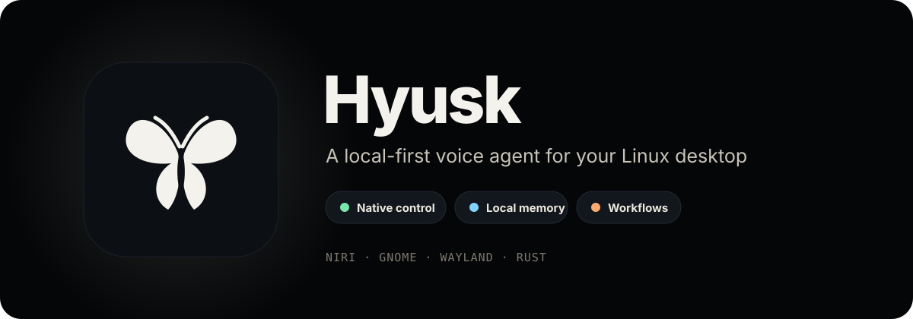
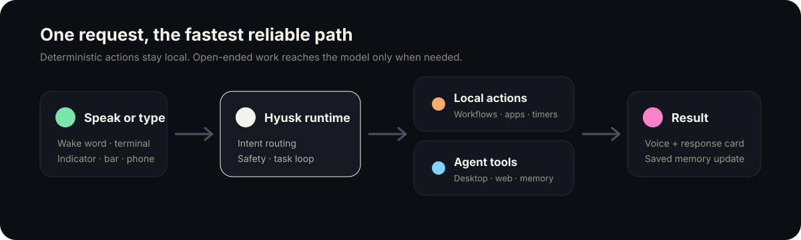
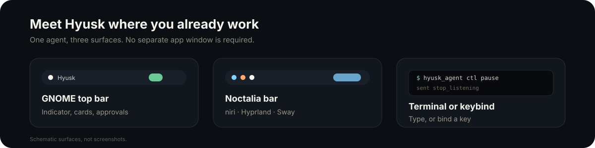

<p align="center">
  
</p>

<h1 align="center">Hyusk</h1>

<p align="center">
  <strong>A local-first voice agent for your Linux desktop.</strong><br>
  Talk or type. Hyusk controls your desktop, runs your routines, and remembers what matters —
  without sending your screen or files to a provider unless it has to.
</p>

<p align="center">
  <a href="https://github.com/Goutam-11/hyusk/actions/workflows/ci.yml"></a>
  
  <a href="LICENSE"></a>
  
  
</p>

<p align="center">
  <a href="#install">Install</a> ·
  <a href="#first-run">First run</a> ·
  <a href="#configuration">Configuration</a> ·
  <a href="docs/tools.md">Tools</a> ·
  <a href="docs/integration.md">Integration API</a> ·
  <a href="docs/development.md">Development</a>
</p>

> **Status: pre-release (0.1.0), not yet a daily driver.** The core agent,
> tools, memory, and the niri/GNOME window adapters are implemented and tested.
> Live provider calls, a live Android reconnect, the indicator panels, the
> portals, and the installer have not all been verified end to end,
> and reliability is still being hardened. Use it with that in mind.

## Why Hyusk

- **Voice first, typing always available.** Say "switch to the browser" or type
  the same request into the terminal; both reach the same agent.
- **Local-first where it counts.** Wake word, speech-to-text, text-to-speech,
  memory, and workflows run on your machine. A model is called only for
  open-ended work.
- **Native Linux control.** niri IPC and the Hyusk GNOME extension manage
  windows; accessibility and the desktop portal handle the rest.
- **Consequential actions ask first.** The approval gate is explicit, audited,
  and cannot be talked around by the model.
- **Yours to extend.** Tools, workflows, MCP servers, external tool processes,
  and every UI surface read the same documented runtime files.

## How it works

<p align="center">
  
</p>

Deterministic requests — apps, sites, windows, timers, workflows — are routed
locally. Open-ended requests go to an OpenAI-compatible provider, with tools,
memory, and approvals flowing through one turn loop. See
[`ARCHITECTURE.md`](ARCHITECTURE.md) for the short version and
[`docs/architecture.md`](docs/architecture.md) for the module walkthrough.

## Requirements

- **Linux**, Wayland or X11. niri and GNOME are first-class; Sway, Hyprland,
  and KDE sessions are detected, while window adapters currently exist for niri
  and GNOME.
- **Rust stable** and a C compiler. Native package lists for Fedora, Debian,
  and Ubuntu are in [`docs/development.md`](docs/development.md).
- **A display session** and at least one provider key (OpenRouter, OpenAI API,
  or Amazon Bedrock Mantle).
- **Optional:** a microphone for voice, a wake-word model, a Whisper model, and
  a Piper voice. Hyusk starts in text mode when they are absent.

## Install

```bash
git clone https://github.com/Goutam-11/hyusk.git
cd hyusk
cp .env.example .env
chmod 600 .env            # the file holds a live provider key
# edit .env and add one provider key, then:
cargo run --release
```

To start Hyusk at login as a user service:

```bash
./scripts/install-autostart.sh
systemctl --user status hyusk.service
journalctl --user -u hyusk.service -f
```

The GNOME indicator, Noctalia widget, and workflow editor have their own
installers in `scripts/`; the Android app is built from `android/`.

## First run

- Type a request in the terminal and press Enter. This works without a
  microphone or any models.
- For voice, download a wake-word model with `./scripts/download-wake-word.sh`,
  set `STT_MODEL` to a Whisper GGML file, and optionally `PIPER_MODEL` to a
  Piper voice.
- To control Hyusk from a keybind, use `hyusk_agent ctl pause` (also `resume`,
  `stop`, `approve`, `approve-turn`, `deny`, `dismiss`). Details:
  [`docs/integration.md`](docs/integration.md).

<p align="center">
  
</p>

## Configuration

Hyusk reads `.env` when present; shell exports take precedence. The most useful
variables:

| Variable | Default | Purpose |
| --- | --- | --- |
| `OPENROUTER_API_KEY` | — | OpenRouter bearer token (or use `OPENAI_API_KEY` / Bedrock). |
| `OPENROUTER_MODEL` | `openai/gpt-4o-mini` | Model identifier. |
| `OPENROUTER_BASE_URL` | `https://openrouter.ai/api/v1` | OpenAI-compatible base URL. |
| `MODEL_VISION` | `1` | Attach screenshots; set `0` for text-only models. |
| `WAKE_WORD_ENABLED` | `1` | Set `0` to skip wake detection. |
| `WAKE_WORD_MODEL` | first available | Wake classifier, e.g. `models/hey_hyusk.onnx`. |
| `STT_MODEL` | `models/ggml-base.en.bin` | Whisper model for post-wake transcription. |
| `PIPER_MODEL` | `models/en_US-lessac-medium.onnx` | Local Piper voice. |
| `HYUSK_WORKSPACE` | current directory | Root for coding tasks and workspace delegation. |

The full list, defaults, and tuning notes are in
[`.env.example`](.env.example); safety and timeout variables are documented in
[`docs/development.md`](docs/development.md).

## What Hyusk can do

- **Windows and workspaces** on niri: list, focus, move, close, return to the
  previous window, filter by workspace, and send to another output. On GNOME,
  the same tool uses the shell extension.
- **Desktop control** through accessibility first, then the portal or native
  input, with screenshots and OCR as fallbacks.
- **Apps, shell, files, media, browser** through dedicated tools; a dedicated
  CDP browser profile keeps automation away from your normal sign-ins.
- **Memory and preferences** stored locally in SQLite, with a readable export.
- **Timers, reminders, schedules, and workflows** that survive restarts.
- **Background research and coding tasks**, plus external MCP tools, each
  behind its own approval rule.

The complete tool list, schemas, and safety decisions are in
[`docs/tools.md`](docs/tools.md).

## Integrations

| Surface | What it gives you | Docs |
| --- | --- | --- |
| GNOME top bar | State, response cards, approvals, model menu | [gnome-indicator.md](docs/gnome-indicator.md) |
| Noctalia bar | The same on niri, Hyprland, and Sway | [noctalia-indicator.md](docs/noctalia-indicator.md) |
| Terminal / keybind | Text turns and `hyusk_agent ctl` | [integration.md](docs/integration.md) |
| Android app | Typed remote actions over an opt-in TLS link | [android-agent.md](docs/android-agent.md) |
| Workflow editor | Edit and run local workflows | [development.md](docs/development.md) |

The runtime files are a versioned contract: `hyusk-status.json` (read-only) and
`hyusk-control.json` (single-use commands). Any bar, script, or keybind can be a
first-class client via [`docs/integration.md`](docs/integration.md).

## Troubleshooting

- **Wake word does not fire.** Run `./scripts/download-wake-word.sh`, or set
  `WAKE_WORD_ENABLED=0` to use text only.
- **No microphone.** Check the system input device; startup continues in text
  mode when no default device exists.
- **Desktop actions fail.** Ask the assistant to run `desktop_doctor`; it
  reports the session, window backend, portal, AT-SPI, CDP, OCR, and `.env`
  state, with advice for the current compositor.
- **No speech output.** Install `piper` and a player (`paplay` or `aplay`), or
  let it fall back to `espeak-ng`.
- **Service logs.** `journalctl --user -u hyusk.service -f`.

## Development

```bash
cargo fmt --all -- --check
cargo clippy --all-targets --offline
cargo test --all-targets --offline -- --test-threads=4
```

The default suite is 524 passing and 6 ignored; feature builds and the isolated
test environment are documented in [`docs/development.md`](docs/development.md),
along with prerequisites, the installer, and known gaps. The propose-diff and
review loop is [`docs/self-upgrade.md`](docs/self-upgrade.md); the work record
is [`issues/README.md`](issues/README.md).

## License

Hyusk is released under the [MIT License](LICENSE).
